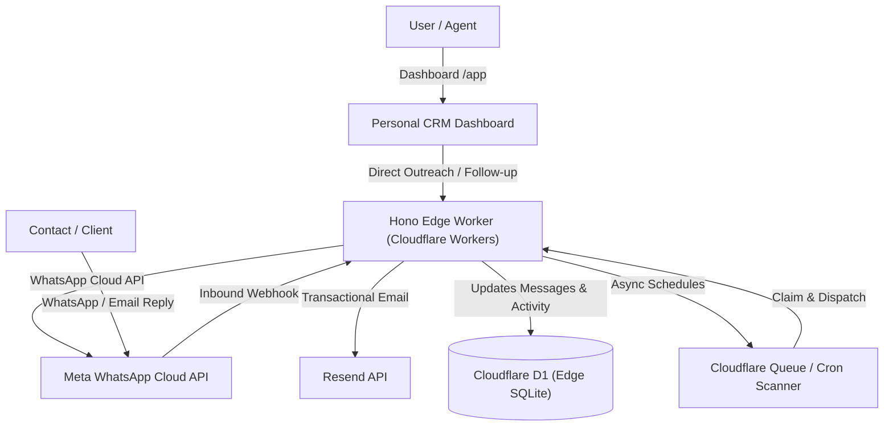

# Collectrr V2 — Personal CRM Technical Architecture & System Guide

Welcome to the Collectrr architectural and engineering guide. This document provides an exhaustive, authoritative breakdown of how Collectrr works under the hood for contributors, architects, and engineers modifying the system.

---

## Client ownership foundation (migration 0007)

Collectr now has a dedicated `clients` table owned by `firm_id`. Migration 0007 copies existing contact identity fields without deleting or changing contact records, request IDs, links, uploads or audit history. Requests and activities get backfilled `client_id` columns. Firm/identity guards and insert bridges protect older callers while this foundation coexists with CRM routes.

New protected endpoints: `GET /api/clients`, `POST /api/clients` (`name`, `phoneNumber`, optional `email`/`company`), and `POST /api/clients/:id/requests`. Request creation validates the dedicated client identity; public sessions read names from clients. Existing contact request routes remain compatibility aliases. Creating a client atomically creates a legacy contact FK bridge too. CRM notes and conversation fields are not part of the clients API.

This is an additive foundation, not complete physical detachment: requests and activities still retain their old NOT NULL contact foreign keys. Activities remains the atomic document-transition/close audit ledger. The later, separately approved eviction migration must remove those legacy foreign keys before contacts can be dropped. No production migration or deletion is performed by opening this PR. The staff workspace remains a sample-data preview.

## 1. System Vision & Domain Model

Collectrr is a serverless, edge-deployed **Personal CRM for keeping work moving with people**. Built on Cloudflare Workers, Cloudflare D1, and Cloudflare R2, it combines direct omnichannel outreach (WhatsApp Cloud API & Email), 2-way conversation tracking, attention triage, and structured client requests.

### Core Architecture Principles
1. **Contact is Primary**: The core unit of work is the `Contact` (belonging to a `User`). A contact can have active conversations across channels, outstanding requests, scheduled follow-ups, and an activity log.
2. **Generic Requests**: Instead of vertical-specific loan/CA cases, Collectrr manages generic `requests` and `request_items` (e.g. "Send signed contract", "Upload PAN & GST", "Confirm time for Friday").
3. **Decoupled Work State vs Transport Telemetry**:
   - **Work State**: `open` → `waiting_on_them` → `needs_follow_up` → `waiting_on_me` → `completed` | `cancelled`
   - **Transport Telemetry**: `queued` → `sent` → `delivered` → `read` | `failed`
4. **Attention-Centric Triage**: The dashboard triages contacts by actionability:
   - **Needs Attention**: `waiting_on_me` request, failed outbound message, or unread inbound reply.
   - **Needs Follow-Up**: request in `needs_follow_up` state.
   - **Waiting on Them**: request in `waiting_on_them` state or outbound message sent.
   - **Recently Replied**: Inbound response received in the last 48 hours.

---

## 2. Architecture & Tech Stack



### Component Stack
| Layer | Technology | Purpose |
|---|---|---|
| **Edge Compute** | Cloudflare Workers + Hono v4 | Ultra-low latency API routing and static asset delivery at edge points of presence worldwide. |
| **Database** | Cloudflare D1 (Edge SQLite) | ACID transactional database storing contacts, conversations, messages, requests, schedules, and credits. |
| **Blob Storage** | Cloudflare R2 | S3-compatible, zero-egress fee object storage for client documents and attachments. |
| **Messaging** | Meta WhatsApp Cloud API + Resend | Direct outreach templates, 24-hour two-way client chat, and transactional emails. |
| **Scheduling** | Cloudflare Cron + Queues | Robust asynchronous occurrence scanner, JIT credit checks, and crash-resilient dispatching. |
| **Frontend** | Vanilla JS + Modern Design System | Zero-framework-overhead, highly responsive operations dashboard and contact workspace. |

---

## 3. Directory Map & Component Responsibilities

```text
Lekho-Edge/
├── README.md                          # Repository overview & quickstart
├── PROJECT_OVERVIEW.md                # This document: architecture, flows & contracts
├── CONTRIBUTING.md                    # Contributor guide & coding standards
├── SECURITY.md                        # Vulnerability reporting & security practices
├── package.json                       # Root developer entry point
│
└── v2/                                # Active Collectrr V2 Edge Application
    ├── package.json                   # Edge worker package definition & test runner
    ├── wrangler.toml                  # Cloudflare Worker bindings
    │
    ├── migrations/                    # D1 Database Migrations
    │   ├── 0001_personal_crm_schema.sql
    │   ├── 0002_firms_and_memberships.sql
    │   ├── 0003_request_checklist_model.sql
    │   ├── 0004_contacts_firm_phone_unique.sql
    │   ├── 0005_client_links.sql
    │   └── 0006_upload_sessions_and_documents.sql
    │
    ├── src/                           # Backend Application Code
    │   ├── index.js                   # Worker entrypoint, router dispatcher & scheduled/queue handlers
    │   ├── middleware/
    │   │   ├── auth.js                # JWT session verification, firm resolution & role enforcement
    │   │   └── cors.js                # CORS headers & preflight handler
    │   ├── api/                       # REST API controllers
    │   │   ├── auth.js                # User authentication, registration & firm creation
    │   │   ├── contacts.js            # Contact CRUD, attention filters, and workspace loader
    │   │   ├── conversations.js       # Outbound text & template dispatch controllers
    │   │   ├── requests.js            # Generic request lifecycle & checklist items
    │   │   ├── links.js               # Staff client link management (create, revoke, regenerate, list)
    │   │   ├── activities.js          # Activity logging and notes
    │   │   ├── schedules.js           # Schedule creation, listing, cancellation & retry
    │   │   ├── templates.js           # Message template registry
    │   │   ├── credits.js             # Financial ledger, recharge wallet, paise math
    │   │   ├── webhook.js             # Meta WhatsApp webhook verification & event ingestion
    │   │   ├── session.js             # Magic link token session validation
    │   │   ├── upload.js              # Direct document uploads
    │   │   ├── uploads.js             # Validated upload-session initiator (presigned R2 PUT)
    │   │   ├── upload-complete.js     # Verified receipt handler & document creation
    │   │   └── admin.js               # System observability & failure analytics
    │   ├── whatsapp/                  # Protected WhatsApp Transport Layer
    │   │   ├── client.js              # Meta Graph API client & offline mock adapter
    │   │   ├── templates.js           # Template registry & parameter interpolation
    │   │   ├── pipeline.js            # Authoritative messaging pipeline with atomic locks & reservations
    │   │   ├── window.js              # 24-hour Meta service window calculation
    │   │   └── webhook.js             # Inbound payload parser & phone normalizer
    │   ├── email/                     # Outbound Email Outreach Module (Resend)
    │   │   ├── client.js              # Resend REST client with Idempotency-Key support & mock adapter
    │   │   ├── templates.js           # Responsive HTML & plain-text email renderer
    │   │   └── pipeline.js            # Authoritative email dispatch pipeline
    │   ├── scheduler/                 # Asynchronous Scheduling Engine
    │   │   ├── time.js                # Timezone conversion preserving IANA wall-clock times
    │   │   ├── scanner.js             # Cron scanner with 10-minute crash-window recovery leases
    │   │   └── consumer.js            # Queue consumer with channel routing & JIT credit validation
    │   └── db/
    │       ├── client.js              # D1 client wrapper & compatibility driver
    │       ├── firms.js               # Firm tenancy & membership resolution helpers
    │       ├── client_links.js        # Client link token hashing and resolution
    │       ├── upload_sessions.js     # Upload intent sessions & storage key validation
    │       ├── documents.js           # Firm-scoped document receipt & listing helpers
    │       └── schema.sql             # Canonical Personal CRM database schema
    │
    ├── public/                        # Frontend Web Applications
    │   ├── index.html                 # Marketing landing page
    │   ├── dashboard.html             # Attention triage & contacts dashboard (/dashboard or /app)
    │   ├── case.html                  # Contact workspace, 2-way chat stream, requests & activity feed
    │   ├── staff-workspace.html       # Staff request & document collection preview (/staff-workspace.html)
    │   ├── upload.html                # Client upload session portal
    │   ├── login.html & register.html # User authentication views
    │   ├── css/                       # Stylesheets (dashboard.css, case.css, staff-workspace.css, tokens.css)
    │   └── js/                        # Frontend controllers (app.js, case-detail.js, auth.js, modules/staff-workspace.js)
    │
    └── tests/                         # Node.js Test Suite (100% Offline Compatible)
        ├── contact-model.test.js
        ├── whatsapp-regression-gate.test.js
        ├── whatsapp-workflow.test.js
        ├── scheduling.test.js
        ├── schedule-ui.test.js
        ├── schema-parity.test.js
        ├── status-filtering.test.js
        ├── templates-ui.test.js
        ├── route-auth.test.js
        ├── credits.test.js
        ├── email-outreach.test.js
        ├── link-routes.test.js
        ├── upload-storage.test.js
        ├── upload-url.test.js
        ├── upload-complete.test.js
        ├── dom-integration.test.js
        ├── frontend-syntax.test.js
        ├── bulk-import.test.js
        ├── firm-scoping.test.js
        └── request-checklist.test.js
```

---

## 4. Database Schema Contract (`schema.sql`)

### Core Relational Hierarchy
```text
firms
  ├── firm_members (UNIQUE per firm_id, user_id)
  │     └── users
  ├── contacts (UNIQUE per firm_id, phone_number; firm tenancy boundary)
  │     ├── conversations (1 per contact per channel)
  │     │    └── messages (2-way conversation history & delivery status)
  │     ├── requests (Action items & tasks; scoped by firm_id)
  │     │    └── request_items (Checklist items)
  │     ├── schedules (Automated recurring or one-off reminders)
  │     │    └── scheduled_occurrences (Claimed & processed by Cloudflare Queue)
  │     └── activities (Consolidated audit trail & internal notes; scoped by firm_id)

Supporting Ledgers:
- message_templates: Registry of WhatsApp & Email templates
- whatsapp_messages: Meta Cloud API transport idempotency ledger
- credit_reservations: JIT credit reserve/capture state machine
- credit_transactions: Append-only balance mutations
```

---

## 5. Deployment & Operational Standards

### Dual Deployment Standard
Whenever deploying changes:
1. **Deploy to Cloudflare Workers**: From `v2/`, run `npx wrangler deploy --config ./wrangler.toml` using your real local `v2/wrangler.toml`. The committed `v2/wrangler.toml` contains placeholders only; keep the real config local and gitignored (see #19).
2. **Push to GitHub**: Stage changes, commit with clear semantic message, and run `git push origin main`.

### Offline Test Standard
Run all verification tests without external network dependencies:
```bash
npm --prefix v2 run test:offline
```
All 156 tests execute against local mock adapters and SQLite databases to guarantee zero external latency or API quota consumption during testing.
